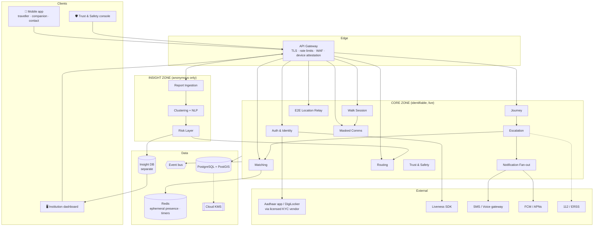
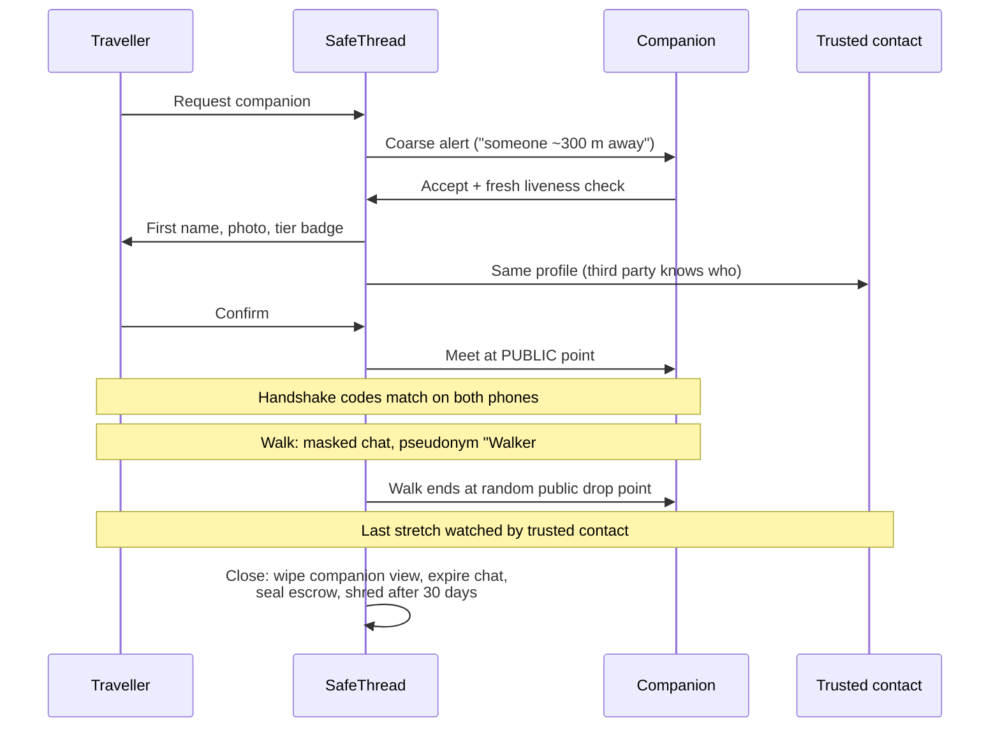

# SafeThread: HLD & Tech Stack (Build Start Document)

> **Prevent harm before it reaches women and children.**
> This is the single reference for starting the build: features, architecture, services, data, security, tech stack, and build order.
> Detailed background lives in `SafeThread_HLD.md` (threat model) and `SafeThread_Verification_and_Anonymity.md` (literature survey).

---

## 1. Product in one line

SafeThread turns what people already sense about risk into **early, private, verifiable action**: avoid the danger, never wait alone, interrupt it fast, and let institutions fix the cause, **without ever becoming a tool to track the people it protects.**

| Window | Goal | Features |
|---|---|---|
| **Avoid** (before trip) | Don't walk into risk | Safety-weighted routing, evidence-aware labels |
| **Reduce** (during trip) | Never alone, never unwatched | Walk With Me, journey protocol, check-ins |
| **Interrupt** (when it goes wrong) | Cut it short | Parallel escalation, verified responders, duress PIN |
| **Fix** (after) | Remove the cause | Anonymous report clustering → institution dashboard |

---

## 2. Main features (MVP scope marked)

| # | Feature | What it does | MVP (campus) |
|---|---|---|---|
| F1 | **Onboarding & trust tiers** | Phone OTP for everyone. ID + liveness only for people who get close to others | ✅ |
| F2 | **Journey protocol** | User/parent-defined check-ins → private prompt → trusted contact → full escalation. Duress PIN, covert SOS | ✅ |
| F3 | **Parallel escalation** | Contacts + 112 + nearby responders alerted at once; push → SMS → voice until a human acknowledges | ✅ |
| F4 | **Trusted contacts** | E2E live location only during journeys/escalations; silent removal | ✅ |
| F5 | **Walk With Me** | Request a verified companion; profile sent to trusted contact; handshake code; random public drop point | ✅ (campus companions) |
| F6 | **Verified responder network** | Coarse alerts to verified people within ~500 m; progressive disclosure | Phase 2/3 |
| F7 | **Anonymous reports** | Place + condition reports, noised on device, clustered, published only above k/m threshold | ✅ |
| F8 | **Evidence-aware labels** | "Strong evidence of concern" / "Some reports" / "Insufficient data". Never "safe" | ✅ |
| F9 | **Safety-weighted routing** | Time + user-chosen caution × risk + accessibility | ✅ (basic) |
| F10 | **Institution dashboard** | Campus/city sees clusters, marks "addressed", tracks report decline | ✅ (campus security) |
| F11 | **Offline-first & battery-aware** | SMS fallback from device, compressed pings, critical-battery mode | ✅ |
| F12 | **Child profiles** | Parent-set protocol, school-route deviation alerts | Phase 3 (needs legal review) |

---

## 3. Architecture overview



### Architectural decisions

| Decision | Why |
|---|---|
| **Two trust zones (Core vs Insight)** with separate DBs and credentials | A breach of analytics reveals no person. Reports never touch identity data |
| **Escalation timer runs on the phone**, with the server as watchdog | Works with no network or a server outage; phone falls back to SMS + dialer |
| **Server relays location without reading it** (E2E encrypted) | Server can't leak, sell, or be compelled to hand over live location |
| **Modular monolith first, split later** | One deployable for the MVP, clear module boundaries, split Escalation/Notification out first when scale demands |
| **Buy identity, liveness, SMS, masking. Build policy** | Vendors already solve the hard infra. Our value is *who sees what, when, for how long* |

---

## 4. Services / modules

| Module | Responsibility | Key rules |
|---|---|---|
| **Auth & Identity** | OTP, device-bound keys, trust tiers, verification orchestration | Store only verification outcome; dedupe via keyed hash; no Aadhaar number, no ID image |
| **Journey** | Journey state machine, protocol config, check-ins, PIN/duress handling, heartbeat watchdog | Duress PIN shows the same screen as the real PIN; 3 wrong PINs → treat as coercion |
| **Escalation** | Parallel fan-out, ack tracking, channel fallback, signed alerts | Idempotent per journey; never waits on one channel |
| **Notification** | Push / SMS / voice delivery | Retries, delivery receipts, signed short codes |
| **Matching** | Find eligible responders/companions nearby | Coarse cell only, per-hour alert caps, no re-matching the same pair within 14 days, filters (women-only, campus-only) |
| **Walk Session** | Walk With Me lifecycle, handshake code, drop points, close + wipe, identity escrow | Pseudonyms per walk; responder never sees destination; escrow shredded after 30 days |
| **E2E Location Relay** | Forwards encrypted location between traveller and contacts/companion | Ciphertext only; no persistence |
| **Masked Comms** | Proxy chat/voice during walks | No phone numbers exchanged; channel expires 30 min after close |
| **Routing** | Safety-weighted routes + trade-off explanation | No route logs tied to users |
| **Report Ingestion** | Accept anonymous reports | No user ID; attestation token only; reject person-identifying text; rate limit |
| **Clustering & Risk** | Spatiotemporal + NLP clustering, Bayesian labels | Publish only ≥ k reports from ≥ m devices; never "safe" |
| **Trust & Safety** | Responder scoring, suspensions, complaint handling, escrow unseal workflow | 2-officer unseal, immutable audit log |
| **Institution Dashboard** | Cluster view, "addressed" status, before/after metrics | Aggregates only, no individuals |

---

## 5. Key flows

### 5.1 Journey → escalation

```mermaid
stateDiagram-v2
    [*] --> Active: start
    Active --> CheckInDue: timer
    CheckInDue --> Active: check-in OK
    CheckInDue --> PrivatePrompt: missed (T1)
    Active --> PrivatePrompt: route anomaly
    PrivatePrompt --> Active: real PIN
    PrivatePrompt --> FullEscalation: duress PIN (silent)
    PrivatePrompt --> ContactAlert: no response (T2)
    Active --> ContactAlert: heartbeat lost
    ContactAlert --> Active: contact confirms safe
    ContactAlert --> FullEscalation: danger / no answer
    Active --> FullEscalation: SOS
    FullEscalation --> Resolved
    Active --> Arrived --> Resolved
```

### 5.2 Walk With Me (with post-walk anonymity)



### 5.3 Report → fix

Device noises location + buckets time → ingestion (no user ID) → cluster by cell × time band × category → hidden until threshold → published to routing risk layer + institution dashboard → institution marks "addressed" → system tracks report decline.

---

## 6. Verification (who is this person?)

| Tier | Who | How verified |
|---|---|---|
| **0 Traveller** | Everyone | Phone OTP + device key. **No ID needed to be protected** |
| **1 ID-verified** | Companions-to-be | Aadhaar app selective share (UIDAI-signed, no Aadhaar number) or DigiLocker → signature verified → random-pose liveness + face match → raw data deleted |
| **2 Campus companion** | MVP companions | Tier 1 + college SSO/email + campus security roll check |
| **3 City responder** | Phase 3 | Tier 2 + digitally signed police clearance (verified at source, never a scan) + training + 2 vouches + probation |
| **Every session** | All above 0 | Fresh liveness at accept + rotating 4-digit handshake code in person |

**Identity escrow:** the traveller and companion are pseudonymous to each other, but the platform keeps a sealed record that only two officers together can open, only on a complaint or lawful request. It is destroyed after the dispute window.

---

## 7. Post-session anonymity (what's left behind)

| Data | Companion sees | Traveller sees | Server keeps |
|---|---|---|---|
| Traveller identity | Never (pseudonym only) | n/a | Escrow only, shredded at 30 days |
| Companion identity | n/a | First name + photo for 7 days | Escrow only, shredded at 30 days |
| Phone numbers | Never | Never | Account only |
| Destination / home | **Never** (random public drop point) | Own | Not stored |
| Live location | During walk only | During walk | Not stored (relay) |
| Route after walk | Nothing ("Completed a walk") | Optional, on-device | Destroyed at close |
| Chat | Until 30 min after close | Same | Not stored |
| Ratings | Aggregated + delayed | Own | Aggregate only |

---

## 8. Data model (core entities)

| Entity | Key fields | Zone | Retention |
|---|---|---|---|
| **User** | id, phone (encrypted), tier, first_name, approved_photo, gender, institution, status | Core | While account active |
| **VerificationRecord** | user_id, tier, method, verified_at, dedupe_hash | Core | While active + re-verification cycle |
| **TrustedContact** | owner_id, contact_id, active, added_at | Core | Until removed (silently) |
| **Protocol** | owner_id, timers, contacts, auto_112, child_profile flag | Core | While active |
| **Journey** | id, user_id, state, started_at, last_heartbeat | Core | 7 days |
| **Escalation** | id, journey_id, recipients, ack status | Core (encrypted) | 90 days or on user request |
| **Walk** | id, traveller_id, companion_id, state, meeting_point, drop_point, closed_at | Core | Ops data destroyed at close |
| **EscrowRecord** | walk_id, ciphertext, officer shares, hold flag | Core | 30 days, then shredded |
| **Complaint** | walk_id, reason, status | Core | Case lifetime |
| **ResponderPresence** | user_id, coarse cell, seen_at | Redis | TTL 2–5 min |
| **Report** | noised cell, time band, category, text, device hash | Insight | 12 months rolling |
| **Cluster** | cell, time band, category, count, devices, addressed | Insight | Long term |
| **AuditLog** | actor, action, target, time | WORM storage | 1–2 years |

---

## 9. External API surface (high level)

| Area | Endpoints (REST) |
|---|---|
| Auth | register, verify OTP, bind device, refresh session |
| Verification | start ID verification, submit liveness, verify institution, submit police clearance, vouch |
| Contacts | add, remove (silent), list |
| Journey | plan, start, heartbeat, check-in, enter PIN, SOS, arrive, confirm arrival |
| Escalation | acknowledge, status (contacts only) |
| Walk | request, accept, confirm, handshake, end, complain, view |
| Responder | go on/off duty, update presence |
| Reports | submit, published clusters (by area) |
| Routing | route with caution level |
| Dashboard | clusters, mark addressed, metrics |
| Realtime | WebSocket: location relay (ciphertext), alerts, walk updates |

---

## 10. Security & privacy baseline

| Area | Control |
|---|---|
| Transport | TLS 1.3, certificate pinning in app, mTLS between services |
| Auth | Device-bound keys (Android Keystore / iOS Secure Enclave); OTP only for onboarding (SIM-swap resistance) |
| Device integrity | Play Integrity / App Attest on sensitive calls (escalate, report, accept) |
| Authorisation | Relationship-scoped: "can X see Y?" is answered only by an active, consented, unexpired session |
| Encryption at rest | Envelope encryption via KMS; field-level encryption for phone/name |
| Live location | End-to-end encrypted; server relays ciphertext |
| Session data | Per-session keys → **crypto-shredding** at close / end of window |
| Reports | On-device geo-noise (planar Laplace ~100 m), time bucketing, no user ID, k/m publish threshold |
| Admin access | No "view user location" feature exists; break-glass needs 2-person approval; immutable audit log |
| Abuse | Responder scoring, alert caps, anti re-match, instant suspension on complaint |
| SDLC | Threat model per feature, SAST/DAST, dependency scanning, pentest before each phase, bug bounty |
| Compliance | DPDP Act 2023 + DPDP Rules 2025 (consent, children, 72 h breach notice); UIDAI offline-verification registration |

---

## 11. Tech stack

### 11.1 Mobile app

| Layer | Choice | Why |
|---|---|---|
| Framework | **Flutter** | One codebase for Android + iOS, good performance on low-end Android (most of the user base), strong offline storage |
| Native modules | Kotlin (Android) / Swift (iOS) via platform channels | Background location, SMS sending, power-button/volume triggers, keystore, FLAG_SECURE |
| Local storage | **SQLite (Drift)** + encrypted via SQLCipher | Offline queue, journeys, check-ins |
| Secure keys | Android Keystore / iOS Secure Enclave | Device-bound keys, E2E keys |
| E2E crypto | **libsignal** or **MLS (OpenMLS)** | Group-encrypted location sharing with contacts |
| Maps | **MapLibre GL** + OpenStreetMap tiles | Free, open, offline tiles possible |
| Background location | Fused Location Provider / CoreLocation with significant-motion APIs | Battery-aware |
| Push | **FCM** (Android) / **APNs** (iOS) | Standard |
| Integrity | Play Integrity API / App Attest | Blocks bots and emulators |

### 11.2 Backend

| Layer | Choice | Why |
|---|---|---|
| Language / framework | **Python + FastAPI** (MVP) → move hot paths (relay, escalation) to **Go** later | Team speed now, performance later |
| Architecture | Modular monolith → extract Escalation + Notification first | Simple to ship, easy to split |
| Realtime | **WebSockets** (FastAPI) behind a load balancer; later a dedicated Go relay | Live location and alerts |
| Primary DB | **PostgreSQL 16 + PostGIS** | Relational data + geospatial queries |
| Ephemeral store | **Redis** (GEO, TTL keys, timers, rate limits) | Responder presence that expires by design |
| Event bus | **NATS JetStream** (MVP) or **Kafka** (scale) | Escalation events, audit stream, report pipeline |
| Background jobs | **Celery** or **Arq** on Redis | Watchdog, retries, shredding jobs |
| Routing engine | **Valhalla** (custom costing) on OSM data | Supports custom edge costs per segment |
| Insight pipeline | Python: **HDBSCAN / ST-DBSCAN**, **sentence-transformers** (multilingual) + small classifier | Cluster reports, filter person mentions, classify concern type |
| Dashboard | **Next.js + MapLibre** | Fast to build, map-heavy UI |
| Trust & Safety console | Next.js (internal, behind SSO + 2FA) | Review queue, suspensions, unseal workflow |

### 11.3 Third-party services (buy, don't build)

| Need | Option (India) |
|---|---|
| ID verification | Aadhaar app selective sharing / offline e-KYC; DigiLocker via a licensed KYC aggregator |
| Liveness + face match | Licensed liveness SDK vendor |
| Police clearance | State police portals / Passport Seva PCC (digitally signed) |
| SMS / voice / number masking | Indian telecom-grade CPaaS provider (DLT-registered for SMS) |
| Emergency | 112 via device dialer/SMS (MVP); ERSS integration via partnership (later) |

### 11.4 Infrastructure

| Layer | Choice |
|---|---|
| Cloud | **AWS Mumbai (ap-south-1)** or **GCP Mumbai**, with data in India for DPDP |
| Containers | Docker → **ECS Fargate / Cloud Run** (MVP) → Kubernetes when needed |
| IaC | **Terraform** |
| Secrets & keys | **AWS KMS / GCP KMS** + Secrets Manager / Vault |
| Edge | Cloud load balancer + **WAF**, rate limiting |
| Storage | S3/GCS with WORM (object lock) for audit logs |
| Observability | **OpenTelemetry** + Grafana / Prometheus + Sentry (with PII scrubbing) |
| CI/CD | **GitHub Actions** with SAST (Semgrep), dependency scan (Dependabot/Trivy), container scan |

---

## 12. Reliability targets

| Path | Target | How |
|---|---|---|
| Escalation | **Works with server down** | Phone-side timer + direct SMS + dialer |
| Escalation (online) | 99.95% | Multi-AZ, queue-backed fan-out, idempotent retries |
| Matching | 99.9% | Stateless + replicated Redis |
| Routing / insights | 99.5% | Degrade to normal routing with a banner |
| Alert ACK latency | p95 < 30 s for first human ACK | Push → SMS → voice ladder |

---

## 13. Repo layout (planned)

```
safethread/
├── docs/                 HLD, verification & anonymity, threat model, ADRs
├── mobile/               Flutter app (+ native Android/iOS modules)
├── backend/              FastAPI modular monolith
│   ├── identity/  journey/  escalation/  notification/
│   ├── matching/  walks/  relay/  comms/  routing/  trust_safety/
├── insight/              Report ingestion, clustering, risk (separate deployable)
├── dashboard/            Next.js institution dashboard + T&S console
├── routing-engine/       Valhalla config + custom costing
└── infra/                Terraform, CI pipelines
```

---

## 14. Build order (campus MVP, ~12 weeks)

| Weeks | Milestone | Done when |
|---|---|---|
| 1–2 | **Foundation**: repo, CI, infra, auth (OTP + device keys), trusted contacts | User can sign up and add contacts |
| 3–4 | **Journey + escalation**: state machine on phone + server watchdog, duress PIN, push/SMS/voice ladder, SMS fallback from device | Missed check-in reliably reaches a contact, even offline |
| 5–6 | **Verification**: Tier 1 (Aadhaar/DigiLocker + liveness) and Tier 2 (college) | Verified companions exist |
| 7–8 | **Walk With Me**: matching, handshake, masked chat, drop points, close + wipe + escrow | Full walk works end-to-end with nothing left behind |
| 9–10 | **Reports + risk + routing**: on-device noise, clustering, labels, Valhalla costing, campus dashboard | Campus security sees a real cluster |
| 11 | **Red-team week**: try to stalk after a walk, fake a companion, poison reports, spoof alerts | Every break found is fixed |
| 12 | **Pilot launch** with campus security; external pentest | Live on one campus |

**Team (minimum):** 2 mobile, 2 backend, 1 data/ML (insight + routing), 1 security/T&S (part-time), and a campus security liaison.

---

## 15. Success metrics

- % of journeys where a riskier route was avoided
- Anomaly → guardian notified (median minutes)
- Alert → first human acknowledgement (p95 seconds)
- Walk With Me fulfilment rate and time-to-match
- Clusters marked "addressed" and **report decline after the fix** (headline metric)
- False-alarm rate, companion incident rate, privacy incidents (target 0)

---

## 16. Open items before build

1. Legal review: DPDP rules for children's journey monitoring; UIDAI offline-verification registration; responder liability
2. Campus partnership MoU (data sharing = aggregates only)
3. Choose KYC + CPaaS vendors (sandbox access first)
4. Escrow unseal policy: who approves, timelines, user notification
5. Local-language support plan (Kannada, Hindi first)
