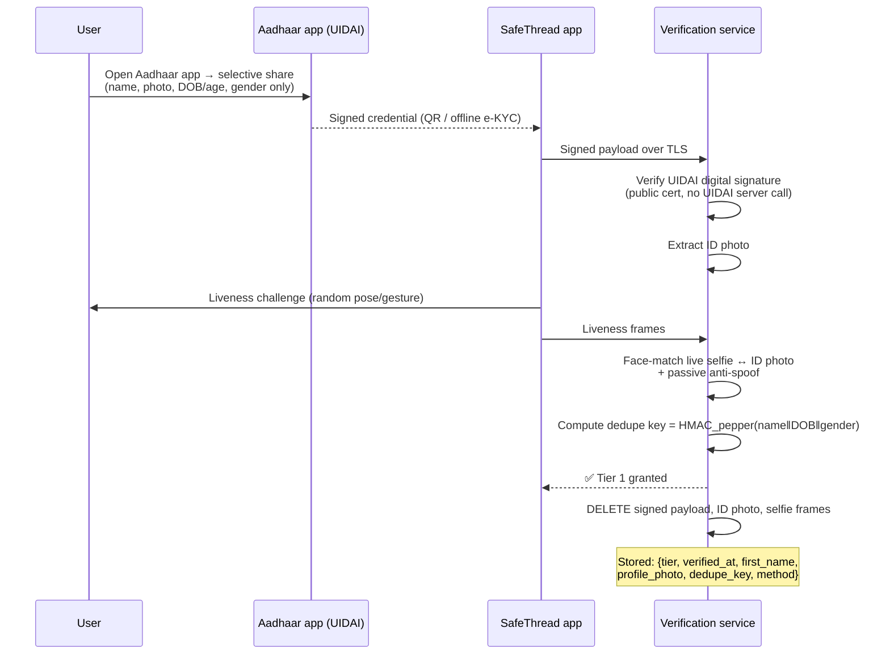
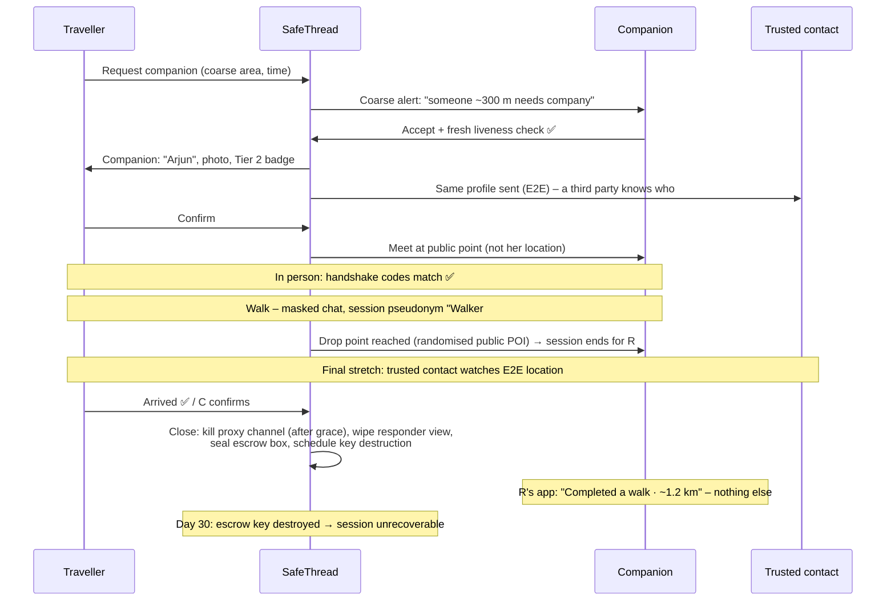

# SafeThread: Verification & Post-Session Anonymity

## Current implementation note (2026-11-14)

For the prototype, a responder can separately opt in to a reusable Walk With Me face reference after the ID-portrait/selfie comparison succeeds. SixthSense keeps only a Fernet-encrypted CompreFace calculator embedding, its calculator version, and consent metadata; the ID and selfie images are sent transiently to the local matcher and are not stored in the Core database. Before a companion accepts a walk, the server requires current companion eligibility and compares a newly captured selfie against the stored embedding. The account holder can delete the embedding from the verification result screen. This is a face-match gate, not liveness detection or proof that the supplied ID is authentic. The local walk lifecycle and companion role-grant flow still need integration.

> Companion to `SafeThread_HLD.md`. This document goes deep on the two pillars that decide whether the responder network and Walk With Me are trustworthy:
>
> 1. **Who is this person?** How exactly people are verified, so a stranger walking beside you is accountable.
> 2. **What's left behind?** How both sides become strangers again once the walk ends, so the system never becomes a stalking tool.
>
> Everything here uses infrastructure that **already exists in India** and patterns **already proven elsewhere**. The novelty is in combining them, not in inventing new tech.

---

## Part A: Literature survey (what the evidence says)

### A1. The problem girls and women actually face

| Finding | Source | What it means for SafeThread |
|---|---|---|
| A 2021 online survey across metropolitan areas found **~56% of women who used public transport reported sexual harassment** | World Bank (2021 survey) | Harm is routine and everyday, not limited to "dangerous zones" |
| Hyderabad (BITS Pilani, 583 respondents): touching (58.8%) and groping (53.2%) were most common; **CCTV and adequate lighting significantly improved sense of safety**; travelling in groups mattered too | BITS Pilani Hyderabad, *Transportation Research Record* | Lighting-aware routing and "never walk alone" are evidence-backed, not guesses |
| Chennai (AWARE, 1,400+ respondents): 50% harassed on public transport; **51.8% did not believe others would help** a woman being abused | AWARE, Chennai | The bystander gap is the core problem. A *verified, willing* responder fills it |
| Breakthrough India bystander survey: ~7 in 10 experienced violence in public transport; bystander methods that worked included **swapping seats and physically escorting** the survivor | Breakthrough India | Walk With Me formalises what good bystanders already do |
| Women in India **travel more at off-peak hours** and often with children, while transport is **infrequent at off-peak times** | World Bank | The empty stop at 9 pm is a structural problem → companions + escalation |
| NCRB recorded **4,48,211 crimes against women in 2023**, and NCRB itself cautions figures reflect police-recorded cases, not actual prevalence | NCRB *Crime in India 2023* | Most harm goes unreported → anonymous, place-based reporting is needed |

### A2. What has been tried (and what we learn)

| System | What it does | Lesson for SafeThread |
|---|---|---|
| **Safetipin** (Delhi, since 2013) | Crowdsourced safety audits on nine parameters (lighting, openness, eyes on the street, security, walkpath, presence of people/women); data used with Delhi govt bodies | Place-based audit data **does** get acted on by cities. Our clustering is the passive, continuous version of this |
| **GoodSAM** (UK, Australia, NZ) | Ambulance control alerts **verified** volunteers within ~300–500 m to start CPR before the ambulance arrives; responders submit ID + credentials and are approved by a verifying organisation; decline → next responder alerted | **A verified-stranger responder network already works at national scale.** We copy its governance model, not just its UI |
| **Uber 2014 Delhi case** | Driver was using a **forged police character certificate**; police said the local-station-only check missed prior cases elsewhere | **Never trust a document you're shown. Verify from the issuing source.** Single checks fail; verification must be layered and continuous |
| **Uber privacy features** | Phone number anonymisation via proxy numbers; **address anonymisation** in driver trip history; **profile data expiration** (driver photo/profile removed from rider view after 48 h, plate after 30 days) | Post-session anonymity is a solved product pattern in ride-hailing. We adopt and tighten it |
| **Strava privacy zones** | Circular zones hiding home locations were broken: an attack recovered the protected location for **up to 85%** of zones (ACM CCS 2022) | **Naive location hiding fails.** A fixed radius circle around home leaks home. Drop-off points must be randomised and snapped to public places |
| **Bumble / Tinder verification** | Random-pose selfies and ID + liveness checks via vendors; Bumble's vendor (Veriff) keeps ID/selfie images up to 72 h; Tinder warns its badge doesn't guarantee safety | Verification proves *identity*, not *character*. Keep raw images briefly and add behavioural safeguards on top |

### A3. India's legal & identity rails (2025–26)

- **Aadhaar & private entities.** The Supreme Court (2018) struck down Section 57, limiting private use of online Aadhaar e-KYC. **Offline verification stayed legal**: the Aadhaar Paperless Offline e-KYC XML is digitally signed by UIDAI and does not expose the full Aadhaar number.
- **2025 amendment.** The *Aadhaar Authentication for Good Governance Amendment Rules, 2025* let private entities apply (via a ministry, reviewed by UIDAI) for Aadhaar authentication. Some lawyers argue this re-legislates what the court struck down, so **don't build the MVP on it**.
- **New Aadhaar app (launched Jan 2026).** Supports **selective credential sharing**, QR-based offline verification, and face verification for proof of presence. UIDAI is moving to require registration of offline-verification entities. **This is our primary rail.**
- **DigiLocker.** Consented pull of government-issued documents (DL, PAN, voter ID, Aadhaar) through partner APIs / licensed aggregators. **This is our fallback rail.**
- **Police verification.** Many states issue **digitally signed** character/clearance certificates online (Haryana, Telangana's i-Verify, Delhi, UP), plus Passport Seva PCC.
- **DPDP Rules 2025 (notified Nov 2025).** Verifiable parental consent for under-18s (DigiLocker/authorised tokens accepted), breach notice to the Board within 72 h, retention/erasure duties. The Act also **restricts tracking and behavioural monitoring of children**, so child journey features need explicit legal review.

---

## Part B: Pillar 1, Verification

### B1. Design principle: a trust ladder, not a single check

The Uber 2014 case shows that one check at sign-up fails: documents get forged, checks are local, and people change. So verification is **layered** (several independent signals) and **continuous** (re-proved at the moment of each walk).

```
           ┌──────────────────────────────────────────────────────────────┐
  TIER 3   │  CITY RESPONDER                                              │
           │  Tier 2 + police clearance (verified at source) + training   │
           │  + 2 vouches + probation + annual re-verification            │
           ├──────────────────────────────────────────────────────────────┤
  TIER 2   │  CAMPUS COMPANION                                            │
           │  Tier 1 + institutional affiliation (college/employer)       │
           ├──────────────────────────────────────────────────────────────┤
  TIER 1   │  ID-VERIFIED                                                 │
           │  Signed gov ID + liveness selfie matched to ID photo         │
           ├──────────────────────────────────────────────────────────────┤
  TIER 0   │  TRAVELLER                                                   │
           │  Phone OTP + device-bound key. NO ID needed to be protected  │
           └──────────────────────────────────────────────────────────────┘
        + EVERY SESSION: fresh liveness check + in-person handshake code
```

**Key rule:** protection is never gated behind KYC. Anyone can use routing, check-ins and escalation. **Only people who get close to someone else** (companions and responders) climb the ladder.

### B2. Exactly how each check works

#### Check 1: Government ID, verified from source (Tier 1)

**Primary path: Aadhaar offline verification (no Aadhaar number collected)**



- **What gets verified:** the UIDAI signature proves the data came from the government, not from a photoshopped card. The face match proves the person holding the phone is that person. The liveness challenge (random pose, like Bumble's 100-pose method) blocks printed photos and replayed videos.
- **What gets stored:** only `tier`, `verified_at`, `first_name`, a profile photo the user approves, and a **keyed hash** used to stop one person creating multiple accounts. **No Aadhaar number, no ID image, no address.** The pepper lives in an HSM.
- **Compliance step:** register as an offline verification seeking entity with UIDAI as required.

**Fallback path: DigiLocker document pull** (for people without the new app): consent-based fetch of DL / PAN / voter ID through a licensed KYC aggregator, then the same liveness + face match.

> **Build vs buy:** buy the liveness/face-match SDK and DigiLocker access from a licensed vendor. Build only the signature check, the dedupe hash, and the delete-after-verify step.

#### Check 2: Institutional affiliation (Tier 2, campus pilot)

- College SSO / college email domain **plus** a campus security office sign-off (a one-time list match against enrolment records the college already has).
- **Why this matters:** in the pilot, every companion is a known member of a closed community with a disciplinary body. Accountability is real, and that is why the pilot is low-risk.

#### Check 3: Police clearance, verified at source (Tier 3)

- The user obtains a **digitally signed** police clearance/character certificate from their state portal or Passport Seva PCC.
- **We verify the digital signature or use the portal's verification lookup.** We **never** accept a scan or photocopy (the exact failure in the 2014 case).
- If the user has lived in multiple states, we require a PCC (national-level) rather than a single-station certificate, which closes the "relocate and get a clean certificate" gap police themselves admitted.

#### Check 4: Training + probation (Tier 3)

- Short mandatory module: role is **companion/witness, never enforcer**; de-escalation; when to call 112; consent and boundaries.
- **Probation:** first N sessions are Walk With Me only (not emergency response), **only with group walks or daytime**, and need strong ratings before full responder status.

#### Check 5: Vouching (Tier 3)

- Two existing Tier 3 responders (or a partner org: NGO, RWA, employer) vouch. Vouchers share accountability: if the person they vouched for is suspended, their own trust score drops.
- Mirrors GoodSAM's "verifying organisation" model and makes Sybil attacks expensive.

#### Check 6: Every-session proof (all tiers above 0)

| Moment | Check | Blocks |
|---|---|---|
| Responder taps **Accept** | Fresh 2-second liveness + face match against stored profile photo | Account selling/sharing, stolen phones |
| Meeting in person | **Rotating handshake code** shown on both phones must match (or QR scan) | Impostors claiming to be "the SafeThread person" |
| Traveller sees responder | Verified first name + photo + tier badge, sent to trusted contact too | A third party knows exactly who is walking with her |

#### Check 7: Continuous trust (after verification)

Verification proves identity. Behaviour proves trustworthiness. The system keeps scoring:
- accept-but-don't-complete ratio, proximity patterns, repeat-targeting of the same area or person, complaint rate, rating trend
- **One serious complaint → instant suspension pending review.** Re-verification yearly, plus liveness at every accept.

### B3. Identity escrow: pseudonymous to users, accountable to the system

The traveller sees only a first name and photo. The responder sees only "Walker #K7Q2." But the platform holds a **sealed mapping** from session to real identity:

```
session_id ──► sealed_box( responder_user_id, traveller_user_id, coarse_route, timestamps )
                    │
                    └─ encrypted with a key split across two officers (2-of-2)
                       unsealed ONLY on: a filed complaint or a lawful police request
                       every unseal is logged immutably and the user is notified when lawful
                       auto crypto-shredded after the dispute window (e.g. 30 days)
```

This turns verification into **deterrence**: a would-be abuser knows they are anonymous to the victim but **not** to the system. And for innocent users, nothing is ever revealed.

---

## Part C: Pillar 2, Anonymity after the walk ends

### C1. What can go wrong after a session

| Threat | Example |
|---|---|
| **Re-contact** | Responder saved her number, messages later |
| **Home inference** | Responder walked her to her gate and now knows where she lives |
| **Re-finding** | Responder keeps accepting alerts in her area to "bump into" her |
| **History mining** | Responder scrolls past sessions to see patterns |
| **Retaliation** | Responder sees who gave a low rating or complaint |
| **Server leak / insider** | Breach exposes who walked with whom, where |
| **Screenshotting** | Responder screenshots her profile |

### C2. Mechanisms (each maps to a threat)

#### 1. Session-scoped pseudonyms & keys
- Each walk gets a **fresh random handle** and a **fresh key pair** for both sides. Nothing links Session 12 to Session 47 from the responder's view.
- The responder **never** sees the traveller's real name, phone number, photo (unless the traveller opts in), or account ID.

#### 2. Masked, expiring communication
- In-app chat/voice through a **proxy relay** (the Uber/Exotel number-masking pattern). Real phone numbers are **never exchanged**.
- The channel **dies automatically** a short grace period after the session closes (e.g. 30 min, for "I dropped my keys"-type issues). After that, contact is impossible except through support.

#### 3. Randomised drop points, never the doorstep
- The traveller sets a "private zone" once. The responder's walk ends at a **public drop point** (lit junction, gate, shop) chosen by the app:
  - **randomly offset**, not centred on home, and **snapped to real public POIs**. This avoids the circle-centre geometry that broke Strava's zones
  - **varied across sessions**, so repeat walks don't triangulate home
  - final stretch covered by **trusted contact monitoring** (E2E live location) instead of the responder
- The traveller can always override ("walk me to the door"), but it's **opt-in**, never the default.

#### 4. Zero history on the responder side
- After close, the responder app shows only: *"Completed a walk · Tue evening · ~1.2 km · thank you."* **No map, no route, no handle, no photo.**
- Mirrors Uber's address anonymisation and profile expiration, but **immediate** instead of after 48 h.

#### 5. Expiring view on the traveller side
- The traveller keeps the responder's first name + photo for the **dispute window** (e.g. 7 days) in case she needs to report, then it auto-expires. A complaint already filed preserves it inside the escrow, not on her phone.

#### 6. Anti re-matching (unlinkability)
- The matcher **won't pair the same responder with the same traveller again** within N days unless **she** marks him as a "trusted companion."
- Responders can't browse, search, or filter travellers. Combined with coarse alerts and per-hour caps (HLD §4.3), this blocks "farming" a specific person.

#### 7. Delayed, batched ratings
- Ratings are revealed to responders only **aggregated** after k ratings, with delay. A responder can't tie one low score to one walk, so there is **no retaliation**.

#### 8. Crypto-shredding on the server
- All session data is encrypted with a **per-session data key**.
- At session close, operational data is deleted. Only the sealed escrow box remains.
- At the end of the dispute window, the **key is destroyed**, so the data becomes unrecoverable **even in backups**. That is simpler and more reliable than hunting down every copy.
- Keep only the minimum pseudonymised operational logs required by law (DPDP Rules impose some log-retention duties; get legal review on exact scope).

#### 9. Screenshot friction
- `FLAG_SECURE` on Android blocks screenshots of profile/handshake screens. iOS detects screenshots, and the event is flagged to trust & safety.
- **Honest limit:** someone can still photograph the screen with another phone. That's why the profile shown is minimal and expires.

### C3. The full lifecycle of one Walk With Me session



### C4. Retention table (anonymity-focused)

| Data | Responder can see | Traveller can see | Server keeps |
|---|---|---|---|
| Traveller identity | Never | n/a | Inside escrow only, until shred |
| Responder identity | n/a | First name + photo, 7 days | Inside escrow only, until shred |
| Phone numbers | Never | Never | Account record only, never shared |
| Live location | During session, from meeting point to drop point | During session | **Not stored** (relay only) |
| Exact destination | **Never** | Yes (own) | Not stored |
| Route / map | Never after close | Own history, optional, on-device | Coarse route in escrow, until shred |
| Chat | Until grace period ends | Until grace period ends | Not stored (E2E), or in escrow if reported |
| Rating | Aggregated, delayed | Own ratings | Aggregate only |

---

## Part D: Why this is practical (not hard)

### D1. Build vs buy

| Component | Buy / reuse | Build |
|---|---|---|
| ID verification | Aadhaar app selective share (UIDAI), DigiLocker via licensed aggregator | Signature check, dedupe hash, delete-after-verify |
| Liveness + face match | Vendor SDK | Random-pose challenge wrapper |
| Police clearance | State portals / Passport Seva (digitally signed) | Signature/lookup check |
| Masked calling & chat | Number-masking provider (same pattern as ride-hailing) | Session-bound expiry |
| Crypto-shredding | Cloud KMS (per-session keys, scheduled destruction) | Key lifecycle logic |
| Matching rules | Redis GEO | Anti re-match, caps, coarse alerts |
| Trust & safety | n/a | Scoring rules + review queue |

Most of the hard parts **already exist**. What SafeThread builds is the **policy layer**: who sees what, when, and for how long.

### D2. Phase 1 (campus pilot) in practice

| Week | Deliverable |
|---|---|
| 1–2 | Tier 0 onboarding, device keys, trusted contacts, journey check-ins |
| 3–4 | Tier 1 via Aadhaar app/DigiLocker + liveness (vendor sandbox); Tier 2 via college SSO + security office list |
| 5–6 | Walk With Me: coarse alerts, handshake code, masked chat, randomised drop points |
| 7 | Session close: view wipe, channel expiry, escrow sealing, scheduled key destruction |
| 8 | Red-team week: try to re-find a traveller after a walk, try to fake a companion, then fix what breaks |

**Why campus first:** a closed community, an existing disciplinary authority, college-verified identities, short distances, and campus security as a partner. That gives the strongest accountability at the lowest risk.

### D3. The one-paragraph pitch

> *SafeThread borrows the verified-volunteer model that ambulance services already trust (GoodSAM), verifies identity from India's signed government sources instead of photocopies (the gap that failed in the 2014 Delhi case), and applies the post-trip privacy patterns ride-hailing already proved (number masking, address anonymisation, profile expiry), but stricter: responders never learn where a woman lives, can't contact her again, and every session is cryptographically erased after a short dispute window. Strangers become accountable during the walk, and strangers again after it.*

---

## Part E: Open questions for legal/ethics review

1. **Children:** DPDP restricts tracking and behavioural monitoring of children. Confirm how parent-configured journey monitoring fits (consent plus a safety purpose, or an exemption).
2. **Aadhaar route:** confirm registration requirements as an offline verification entity and permitted fields under selective sharing.
3. **Log retention:** reconcile DPDP log-retention duties with crypto-shredding (keep minimal pseudonymous logs separate from session content).
4. **Responder liability:** volunteer protection, insurance, and the clear "witness, not enforcer" role.
5. **Escrow unsealing policy:** who approves, response time, notification to the user, and transparency reporting.

---

## References

- World Bank: *India: Making public transport more women-friendly* — https://blogs.worldbank.org/en/endpovertyinsouthasia/india-making-public-transport-more-women-friendly
- BITS Pilani Hyderabad study (via World Ports) — https://www.worldports.org/?p=651831
- AWARE Chennai survey (The News Minute) — https://www.thenewsminute.com/amp/story/tamil-nadu/does-chennai-deserve-safe-women-tag-survey-public-transport-says-otherwise-65141
- Breakthrough India bystander survey (Morung Express) — https://morungexpress.com/68-have-experienced-violence-while-taking-public-transport-report
- NCRB Crime in India 2023 (Business Standard) — https://bsppd.business-standard.com/amp/india-news/450k-crimes-against-women-recorded-in-2023-up-saw-highest-cases-125093000002_1.html
- Safetipin (Asia Foundation) — https://asiafoundation.org/2016/05/11/SafetiPin-tool-build-safer-cities-women/
- GoodSAM (SCAS NHS; St John NZ; NIAS FAQ) — https://www.scas.nhs.uk/?p=63743 · https://www.stjohn.org.nz/first-aid/lifesaving-apps/goodsam/ · https://nias.hscni.net/download/75/other/5658/public-faq-500m-june-2023.pdf
- Uber 2014 Delhi case: forged certificate & verification gaps (Scroll; Millennium Post) — https://scroll.in/article/694011/scroll_in · https://www.millenniumpost.in/forged-character-certificate-used-by-driver-to-get-job-with-uber-47849
- Uber privacy features (Uber Security & Privacy; Uber India) — https://medium.com/uber-security-privacy/introducing-2-new-privacy-features-for-riders-and-drivers-365c1ca1f3ee · https://www.uber.com/in/en/newsroom/keep-your-number-private-with-phone-anonymisation/
- Strava EPZ inference attacks (ACM CCS 2022) — https://lepoch.at/publication/epz-inference-attacks · https://www.darkreading.com/application-security/popular-fitness-apps-leak-location-data-even-when-users-set-privacy-zones
- Bumble/Tinder verification — https://bumble.com/the-buzz/request-verification · https://www.itechguides.com/?p=967587
- Aadhaar offline e-KYC & 2018 verdict (Vinod Kothari; UIDAI OVSE Playbook) — https://vinodkothari.com/2019/03/aadhaar-ordinance-paving-way-for-use-of-voluntary-aadhaar-by-private-companies/ · https://www.uidai.gov.in/images/OVSE_Playbook.pdf
- Aadhaar Good Governance Amendment Rules 2025 (Scroll; Mondaq) — https://scroll.in/latest/1078654/it-ministry-notifies-rules-allowing-private-entities-to-carry-out-aadhaar-authentication · https://www.mondaq.com/india/data-protection/1583746/aadhaar-authentication-for-private-entities-navigating-the-2025-amendment
- New Aadhaar app (PIB; Business Standard; Telangana Today) — https://pib.gov.in/PressReleasePage.aspx?PRID=2219790 · https://www.business-standard.com/india-news/new-aadhaar-app-selective-sharing-quicker-verification-features-details-126012900173_1.html
- DigiLocker partner access — https://didit.me/blog/digilocker-api/
- State police online verification (Telangana i-Verify; Haryana) — https://telanganatoday.com/police-verification-certificate-facility-i-verify-launched-in-telangana · https://www.tribuneindia.com/news/haryana/now-get-police-verification-certificate-sitting-at-home-41013/amp
- DPDP Rules 2025 (Biometric Update; Bar & Bench; Baker Botts) — https://www.biometricupdate.com/202511/india-notifies-its-sweeping-digital-personal-data-protection-rules · https://www.barandbench.com/view-point/meity-notifies-final-digital-personal-data-protection-rules-2025 · https://ourtake.bakerbotts.com/post/102lund/india-notifies-final-rules-for-digital-data-protection-act
