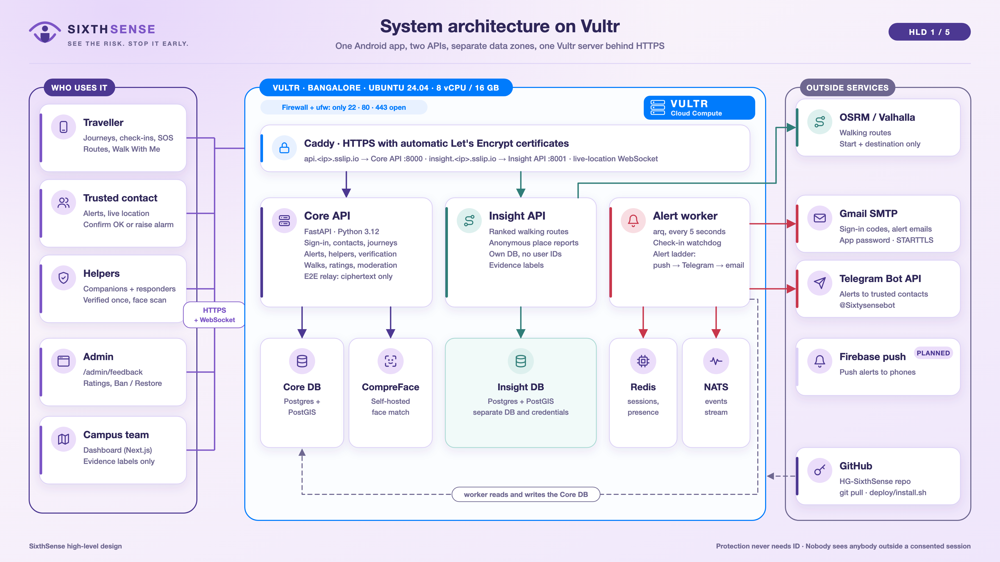
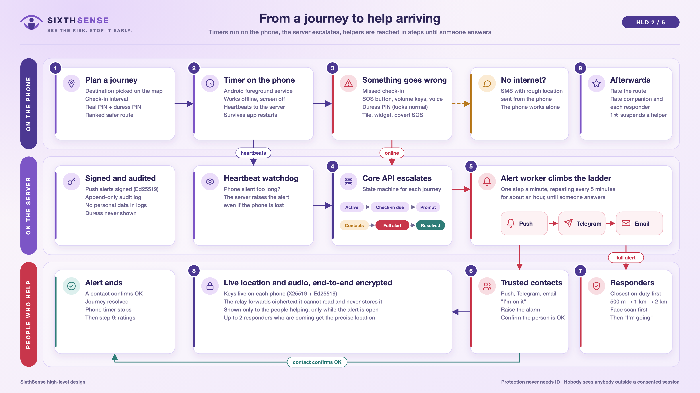
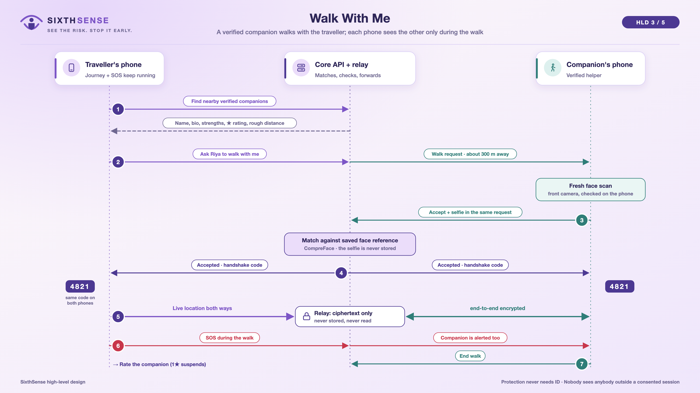
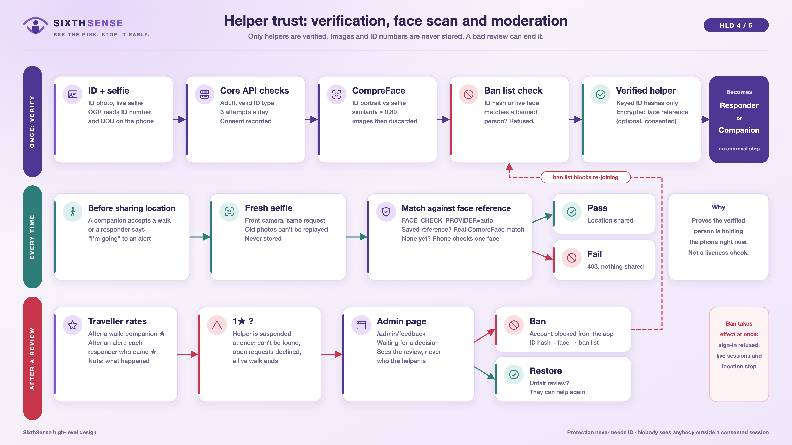
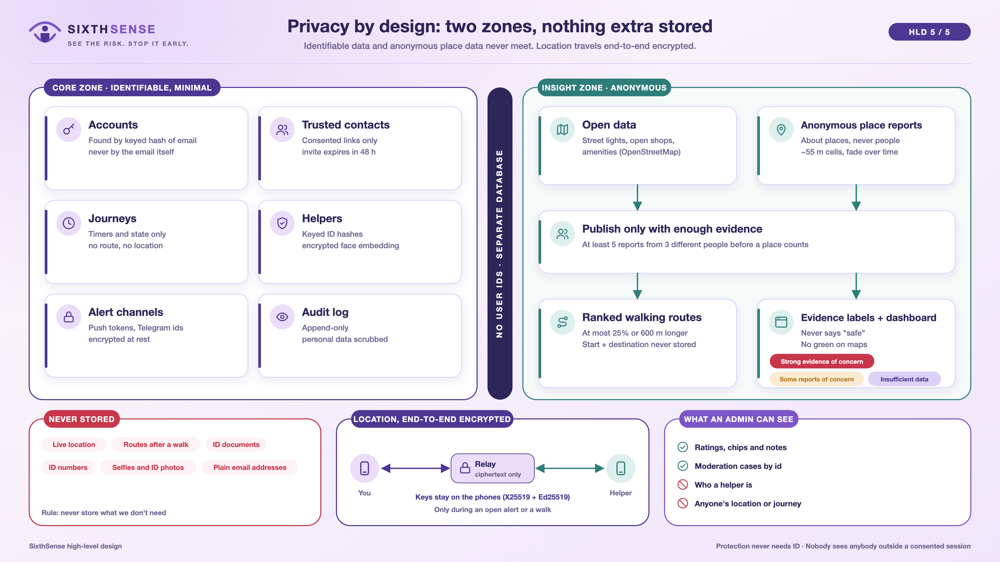

# SixthSense

**See the risk. Stop it early.**

SixthSense is a personal safety platform for women and children. It helps people avoid risky
routes, stay connected to the people they trust during a journey, get help fast when something
goes wrong, and fix the places that make people feel unsafe. It does this without ever becoming
a tool to track the people it protects: nobody can see anybody outside an active, consented
session, and the server keeps as little personal data as possible.

The product works in four layers:

| Layer | What it does |
|---|---|
| **Avoid** | Ranked walking routes that favour lit, busy streets and steer around places with reports of concern. |
| **Reduce** | Journeys with check-in timers, trusted contacts, and verified companions who can walk with you. |
| **Interrupt** | SOS from many triggers, alerts that escalate until someone answers, nearby verified responders, encrypted live location and audio. |
| **Fix** | Anonymous reports about places feed a campus dashboard so the causes can be fixed. |

Deploying to a server: see [`DEPLOY.md`](DEPLOY.md). Detailed design: see [`Docs/`](Docs/)
(the design documents call the product *SafeThread*).



---

## Download and install the app

**[Download the SixthSense Android app (APK)](https://drive.google.com/file/d/1YD-t8q_AAa62WVd5ArUvbQ0niCnqKr8L/view?usp=sharing)**

The APK works on almost every Android phone from the last 7 to 8 years (64-bit, Android 8 or
newer) and connects to the SixthSense test server.

1. Open the link on the phone and download the file (`.apk`). If the link opens in Drive, tap
   the download icon.
2. Open the downloaded file. Android asks for permission to install apps from this source
   (Chrome, Files or Drive): tap **Settings**, turn on **Allow from this source**, then go back.
3. Tap **Install**. If Play Protect warns about an unknown app, tap **More details** and
   **Install anyway** (the app is not on the Play Store yet).
4. If an older SixthSense build is already on the phone, uninstall it first; builds signed with a
   different key cannot update each other.
5. Open SixthSense, enter your email and type the 6-digit code you receive. Check the spam folder
   the first time.

**Allow these when the app asks, so protection keeps working with the screen off:**

| Permission | Why |
|---|---|
| Notifications | Check-in reminders and alerts |
| Location ("while using" and precise) | Live location during an alert or a walk, nearby helpers |
| Alarms & reminders | Reliable check-in timer |
| Battery: Unrestricted | Phone makers' battery savers can stop the timer (Xiaomi, Oppo, Vivo, Realme, Samsung) |
| SMS (optional) | Offline SOS by text when there is no internet |
| Camera | Selfie and face scan, only for companions and responders |
| Microphone (optional) | Voice SOS words and audio evidence |

To point the app at your own server, build it yourself; see [`DEPLOY.md`](DEPLOY.md), section 5.

---

## Contents

1. [Download and install the app](#download-and-install-the-app)
2. [Features for the person travelling](#features-for-the-person-travelling)
3. [Features for trusted contacts](#features-for-trusted-contacts)
4. [Features for companions and responders](#features-for-companions-and-responders)
5. [Ratings, moderation and the admin page](#ratings-moderation-and-the-admin-page)
6. [Routes, place reports and the dashboard](#routes-place-reports-and-the-dashboard)
7. [Privacy and security](#privacy-and-security)
8. [Architecture and design diagrams](#architecture-and-design-diagrams)
9. [Repository layout](#repository-layout)
10. [Running locally](#running-locally)
11. [Configuration](#configuration)
12. [Tests](#tests)

---

## Features for the person travelling

Protection never needs an ID document. Anyone can sign in with an email address and use every
protection feature.

### Sign-in and session
- **Email code sign-in.** The user enters an email address and receives a 6-digit code. Codes
  expire after 10 minutes, allow 5 attempts, and are rate limited per email and per IP.
- **Device-bound key.** On first sign-in the phone creates a key pair in the Android Keystore.
  After that the phone signs in silently with that key, so the user stays signed in across app
  restarts without another email code.
- **Accounts are found by a keyed hash of the email**, never by the plain email address.
- **Log out** from the Profile tab ends the session on the server, retires the phone's device
  key and clears values saved on the phone. Logging out is blocked while a journey is running.

### Profile
- First name, short bio, strengths and languages, collected after the first sign-in and editable
  from the Profile tab. A profile is shown to another person only inside a consented walk.

### Journeys and check-ins
- **Plan a journey** with a destination (picked on a map), a check-in interval and two PINs:
  a **real PIN** and a **duress PIN**.
- **Check-in timer runs on the phone** in an Android foreground service, so it keeps working with
  the screen off, the app in the background, or no internet.
- **Missed check-in** moves the journey to a private prompt on the phone, then to a contact alert
  if there is still no answer.
- **Duress PIN** looks exactly like a normal check-in on the phone (same screen, same response)
  but quietly starts a full alert. This protects someone who is being forced to check in.
- **Journey restore.** The running journey is saved on the phone (encrypted with a Keystore key)
  and picked up again from the server if the app is closed, swiped away or the phone restarts.
  Pressing Back sends the app to the background instead of closing it.
- **Off-route nudge.** If the user strays far from the chosen route, the app gently asks them to
  check in. It never raises an alarm on its own.
- **Ending a journey** stops the timers on the phone and on the server, then asks how it went.

### SOS
- **Many triggers:** the SOS button, pressing the volume buttons, spoken words (for example
  "help" or "bachao", recognised on the phone), a quick-settings tile and a home-screen widget.
- **Covert SOS** escalates on the server while the phone keeps showing a normal journey.
- **Countdown with cancel.** A sudden SOS gives a short countdown that can be cancelled with the
  real PIN; a wrong PIN does not cancel it.
- **Audio evidence.** After an SOS the phone can record audio, and contacts can listen live
  (Audio Escort), always end-to-end encrypted.
- **Offline SMS fallback.** If the phone has no internet during an opted-in journey, it sends an
  SMS with the rough location to chosen numbers directly from the phone.
- **Open alerts are explained.** If an alert is still open on the server, the app says so and
  does not start a new journey that could not reach anyone.

### Live location
- During an alert or a walk, the phone shares its position **end-to-end encrypted** (X25519 key
  agreement and Ed25519 signatures) only with the people helping right now. The server relays
  encrypted frames it cannot read and never stores them.

### Walk With Me
- A traveller sees nearby verified companions (rough distance, bio, strengths, average rating),
  can filter for women only, and asks one to walk with them.
- The companion accepts or declines. On accept, both phones show the same **4-digit handshake
  code** to confirm they have met the right person, and both see each other move on the map.
- The traveller's check-ins and SOS keep running during the walk, and the companion is told if
  an SOS happens.
- Walk With Me has its own tab in the bottom bar.

### Ratings after a journey
- **How was it?** Route stars, chips (well lit, felt uneasy, busy street, poor footpath and
  more) and an optional note. Notes are about places, never people's names.
- **Companion stars** after a walk.
- **Responder stars** after an alert, for each responder who said "I'm going". A warning
  explains that one star suspends that person from helping until the team reviews it.

---

## Features for trusted contacts

- **Invite by link.** The traveller adds up to 5 trusted contacts with an invite link that
  expires after 48 hours. The contact accepts in the app.
- **People tab.** One tab holds both sides of trust: *My people* (who looks out for me) and
  *I support* (who I look out for, with their open alerts).
- **Alerts that escalate until someone answers.** When a check-in is missed or an SOS is sent,
  contacts are alerted step by step: push notification, then Telegram, then email, one step a
  minute, repeating every 5 minutes for about an hour or until someone responds.
- **Signed alerts.** Push alerts are signed with an Ed25519 key, so the app can tell a real alert
  from a fake one.
- **Respond from anywhere.** A contact can say "I'm on it", raise the alarm ("I can't reach
  them"), or confirm the person is OK, from the app or from the link in the Telegram or email
  message. Confirming the person is OK ends the alert.
- **See and hear only during the alert.** Live location and live audio are shown to a contact
  only while that alert is open.

---

## Features for companions and responders

Only people who help others are verified. Verification is done once.

### Identity verification
- **ID photo and selfie.** The helper picks an ID type (driving licence, voter ID or passport),
  enters the ID number and date of birth, uploads a photo of the ID and takes a live selfie.
- **On-device OCR.** The ID number and date of birth are read from the ID photo on the phone
  (ML Kit). Only those two fields are suggested; the raw text is discarded.
- **Face match.** The ID portrait and the selfie are compared by a **self-hosted CompreFace**
  server. The images are used for the comparison and then discarded; they are never stored in
  the SixthSense database.
- **No ID numbers stored.** Only keyed hashes of the ID are kept, to stop one identity being used
  for two accounts. Adults only; a verification expires after a year.
- **Optional face reference.** With separate consent, an encrypted face embedding (not an image)
  is saved for the later face scans.

### Face scan before sharing location
- Each time a companion **accepts a walk** and each time a responder says **"I'm going"**, the
  app takes a quick front-camera selfie and sends it in the same request. It is matched against
  the saved face reference when there is one (otherwise the phone checks that exactly one face is
  present). This confirms the verified person is holding the phone before they receive anyone's
  location. The selfie is never stored.

### Nearby responders
- Verified responders can go **on duty**. Only a rough area (about a 110 m grid square) is kept,
  and only for a few minutes.
- During a full alert, the closest on-duty responders are asked first, and the search radius
  grows (500 m, 1 km, 2 km) if nobody says "I'm going".
- Up to two responders who say "I'm going" receive the traveller's precise live location. The
  traveller sees who is coming.

---

## Ratings, moderation and the admin page

- **Automatic suspension.** A 1-star rating of a companion or a responder suspends that person
  from helping immediately and opens a case for the team.
- **Admin page** at `/admin/feedback`, protected by a username and password:
  - every journey, walk and responder rating, with summary numbers and chip counts;
  - CSV downloads of all ratings;
  - a **Waiting for a decision** queue for suspended helpers, with **Ban** and **Restore**;
  - a **Ban** button on any companion or responder rating, whatever the stars.
- **Admins never see who a helper is.** They act on the rating or the case; the server finds the
  person.
- **Ban.** A banned account is blocked from the app: sign-in is refused, live sessions and the
  live-location connection stop at once, and helper roles and the verified identity are revoked.
  The keyed ID hashes and the encrypted face embedding are kept on a ban list.
- **No coming back.** A new verification is refused if its ID hashes or the live selfie match
  anyone on the ban list.
- **Restore** lets a suspended helper help again when a rating was unfair.
- Admin forms are protected against cross-site requests, and every view, download and decision is
  written to the audit log.

---

## Routes, place reports and the dashboard

- **Ranked walking routes.** For a start and a destination, the Insight service gets walking
  routes from a routing engine (the free public OSRM server, or a self-hosted Valhalla) and ranks
  them by what is around them: street lights, open shops and amenities, and published place
  reports. A recommended route is never more than 25 percent (and 600 m) longer than the shortest.
- **No user ids in route requests.** Start and destination go only in the request and are never
  stored or logged.
- **Anonymous place reports.** Users report places, never people. Reports are grouped into
  roughly 55 m cells and fade over time. A place is published, and affects routes, only after
  enough reports from enough different people (by default 5 reports from 3 people).
- **Evidence labels.** Places are described as *Strong evidence of concern*, *Some reports of
  concern* or *Insufficient data*. The product never calls a place "safe" and never uses green on
  maps.
- **Campus dashboard.** A web map of published clusters with the same evidence labels, for the
  people who can fix the causes.

---

## Privacy and security

These rules shape every feature:

1. **Protection never needs ID.** Only companions and responders are verified. The single
   exception is an account an admin bans after a bad review.
2. **Never store what is not needed.** No live location, no ID documents or ID numbers, no route
   after a walk.
3. **The phone works alone.** Escalation timers run on the device, with SMS fallback when offline.
4. **Nobody sees anybody outside an active, consented session**: not contacts, not companions,
   not admins.
5. **Never say "safe".** Only evidence labels.
6. **Reports are about places, never people.** The Insight service has its own database and no
   user ids, and never shares code or credentials with the Core service.
7. **Every sensitive action is logged append-only**, without personal data. Logs pass through a
   filter that removes personal data as a safety net.

Other measures: secrets are refused unless they are real values outside development; push tokens,
Telegram chat ids and opt-in alert emails are encrypted at rest; tokens and codes are stored only
as keyed hashes; the app blocks screenshots on sensitive screens; and fonts are bundled with the
app rather than fetched at runtime.

---

## Architecture and design diagrams

The five high-level design diagrams below show how SixthSense works end to end. Full-size files
are in [`Docs/images/hld/`](Docs/images/hld/).

### 1. System architecture on Vultr
One Android app, two APIs with separate data zones, and one Vultr server behind HTTPS.


### 2. From a journey to help arriving
Timers run on the phone, the server escalates, and helpers are reached in steps until someone
answers.



### 3. Walk With Me
A verified companion walks with the traveller; each phone sees the other only during the walk.



### 4. Helper trust: verification, face scan and moderation
Only helpers are verified, images and ID numbers are never stored, and a bad review can end it.



### 5. Privacy by design
Identifiable data and anonymous place data never meet, and location travels end-to-end
encrypted.



### In text

```
 Android app (Flutter)
   |  HTTPS + WebSocket (encrypted frames only)
   v
 Caddy (HTTPS) ----> Core API (FastAPI) ----> Core Postgres + PostGIS
                      |   |                    Redis (presence, timers, rate limits)
                      |   +--> alert worker (arq): check-in watchdog, alert ladder
                      |   +--> CompreFace (self-hosted face matching)
                      |   +--> Gmail SMTP, Telegram bot
                      |
                 ---> Insight API (FastAPI) ---> Insight Postgres + PostGIS (no user ids)
                           +--> OSRM or Valhalla (walking routes)
 Dashboard (Next.js + MapLibre) ---> Insight API
```

- **Core API**: accounts, devices, contacts, journeys, alerts, helpers, verification, walks,
  ratings and moderation.
- **Insight API**: routes and anonymous place reports, in a separate service with a separate
  database and separate credentials, so a breach of analytics reveals no person.

---

## Repository layout

| Path | What | Stack |
|---|---|---|
| `mobile/` | Android app (iOS project kept for later) | Flutter |
| `backend/` | Core API, alert worker, admin scripts, migrations | Python 3.12, FastAPI, SQLAlchemy 2, Alembic, uv |
| `insight/` | Routes and place reports service | Python 3.12, FastAPI, SQLAlchemy 2, Alembic, uv |
| `dashboard/` | Campus map dashboard | Next.js 15, MapLibre, pnpm |
| `contracts/` | Shared API contract | OpenAPI |
| `infra/` | Local services: two Postgres, Redis, NATS, Mailpit, CompreFace | Docker Compose |
| `deploy/` | Production installer, HTTPS, systemd services, `.env` generator | Bash, Caddy, systemd |
| `routing-engine/` | Optional self-hosted walking router | Valhalla |
| `Docs/` | High-level design, verification and anonymity, integration notes | Markdown |

Backend modules (`backend/app/`): `identity` (sign-in), `contacts`, `journey`, `escalation`,
`notification`, `comms`, `relay` (live location), `escort` (audio), `matching` (responders),
`verification`, `face_scan`, `walks`, `profiles`, `feedback` (ratings and admin page),
`moderation` (suspend, ban, restore), `trust_safety`, `routing`.

---

## Running locally

Requirements: Docker, [uv](https://docs.astral.sh/uv/), Node 22 (for the dashboard) and Flutter
with the Android SDK (for the app).

```bash
cp .env.example .env
docker compose -f infra/docker-compose.yml up -d --wait
(cd backend && uv sync && uv run alembic upgrade head)
(cd insight && uv sync && uv run alembic upgrade head)
```

Then, each in its own terminal:

| What | Command | Open |
|---|---|---|
| Core API | `cd backend && uv run uvicorn app.main:app --reload --port 8000` | http://localhost:8000/docs |
| Alert worker | `cd backend && uv run arq app.worker.WorkerSettings` | sign-in emails in http://localhost:8025 |
| Insight API | `cd insight && uv run uvicorn app.main:app --reload --port 8001` | http://localhost:8001/docs |
| Dashboard | `cd dashboard && corepack pnpm install && corepack pnpm dev` | http://localhost:3000 |
| App | `cd mobile && flutter run` | emulator or USB phone |

The emulator reaches the computer at `10.0.2.2`. For a phone on the same network, build with
`--dart-define=API_BASE_URL=http://<computer-ip>:8000`.

Face matching locally: start CompreFace (`docker compose -f infra/docker-compose.yml up -d
compreface`), create a Face Verification service at http://localhost:8003 and put its key in
`COMPREFACE_API_KEY`. Without CompreFace, set `FACE_MATCHER=mock` (development only; the
server refuses it in production).

---

## Configuration

All settings live in `.env` (see `.env.example` for every option). The most important:

| Setting | Purpose |
|---|---|
| `ENV` | `dev`, `test` or `production`. Outside dev and test, development secrets are refused. |
| `CORE_DATABASE_URL`, `INSIGHT_DATABASE_URL` | The two separate databases. |
| `OTP_PEPPER`, `TOKEN_SECRET`, `DATA_KEY`, `IDENTITY_HMAC_SECRET`, `FACE_TEMPLATE_KEY`, `REPORT_PEPPER`, `ALERT_SIGNING_KEY` | Secrets. Set once per server; changing some later makes existing data unusable. |
| `PUBLIC_BASE_URL` | Address contacts open from alert links. |
| `SMTP_*` | Email for sign-in codes and alert emails (for example a Gmail App password). |
| `TELEGRAM_BOT_TOKEN`, `TELEGRAM_BOT_USERNAME` | Telegram alerts to contacts. |
| `COMPREFACE_API_URL`, `COMPREFACE_API_KEY`, `COMPREFACE_MATCH_THRESHOLD` | Self-hosted face matching. |
| `FACE_MATCHER`, `FACE_CHECK_PROVIDER` | Face match for verification, and the face scan before sharing location (`auto` recommended). |
| `ADMIN_USERNAME`, `ADMIN_PASSWORD` | Admin feedback and moderation page; off while the password is empty. |
| `PUBLISH_MIN_REPORTS`, `PUBLISH_MIN_DEVICES` | When a reported place is published and affects routes. |
| `ROUTING_PROVIDER`, `ROUTES_AREA_FILE` | Routing engine and the area with route data. |

For a server, `python3 deploy/make_env.py API_DOMAIN INSIGHT_DOMAIN` writes a complete production
`.env` with fresh secrets. `.env` is never committed.

---

## Tests

```bash
(cd backend   && uv run ruff check . && uv run pytest -q)     # needs the local databases running
(cd insight   && uv run ruff check . && uv run pytest -q)
(cd mobile    && flutter analyze && flutter test)
(cd dashboard && corepack pnpm lint && corepack pnpm build)
```
